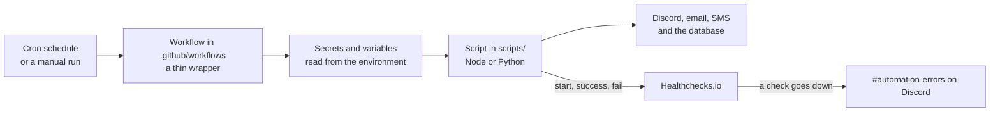

# automations

A collection of scheduled jobs - data syncs, timed reminders and digests - that run on GitHub Actions.

Each job is a cron-scheduled workflow in [`.github/workflows`](.github/workflows) wrapping a short, self-contained script in [`scripts`](scripts). The scripts are deliberately generic and take all of their runtime settings from the environment, so the repository can stay public (and free to run) without carrying anything sensitive.

## Contents

- [`STATUS.md`](STATUS.md) - live per-job health badges (click the badge above), each job's cadence and what it does.
- [`.github/workflows/README.md`](.github/workflows/README.md) - every workflow, its schedule, the UK-time windowed schedule and the Healthchecks.io monitoring.
- [`scripts/README.md`](scripts/README.md) - what each script does and the environment it needs.

## How a job runs

## Conventions

- One workflow per job, named for what it does; the workflow is a thin wrapper and the logic lives in the script.
- Scripts are configured entirely through the environment; nothing configurable is committed.
- Time-of-day jobs hold a fixed UK wall-clock time year-round: each fires across a morning window, gates to its target UK hour and claims the day so it acts once; see the [workflows README](.github/workflows/README.md#uk-time-and-the-windowed-schedule).
- Every scheduled job pings [Healthchecks.io](https://healthchecks.io) on start, success and fail, so a job that stops running or fails alerts instead of failing silently; see [Monitoring](.github/workflows/README.md#monitoring).
- A gitleaks scan runs on every push and pull request.
- Dependabot keeps the action versions current.

## Licence

See [LICENSE](LICENSE).
